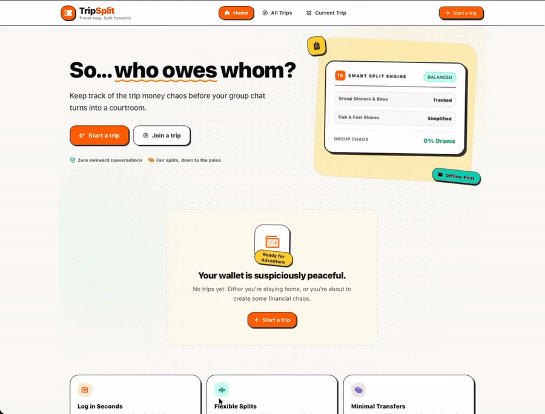
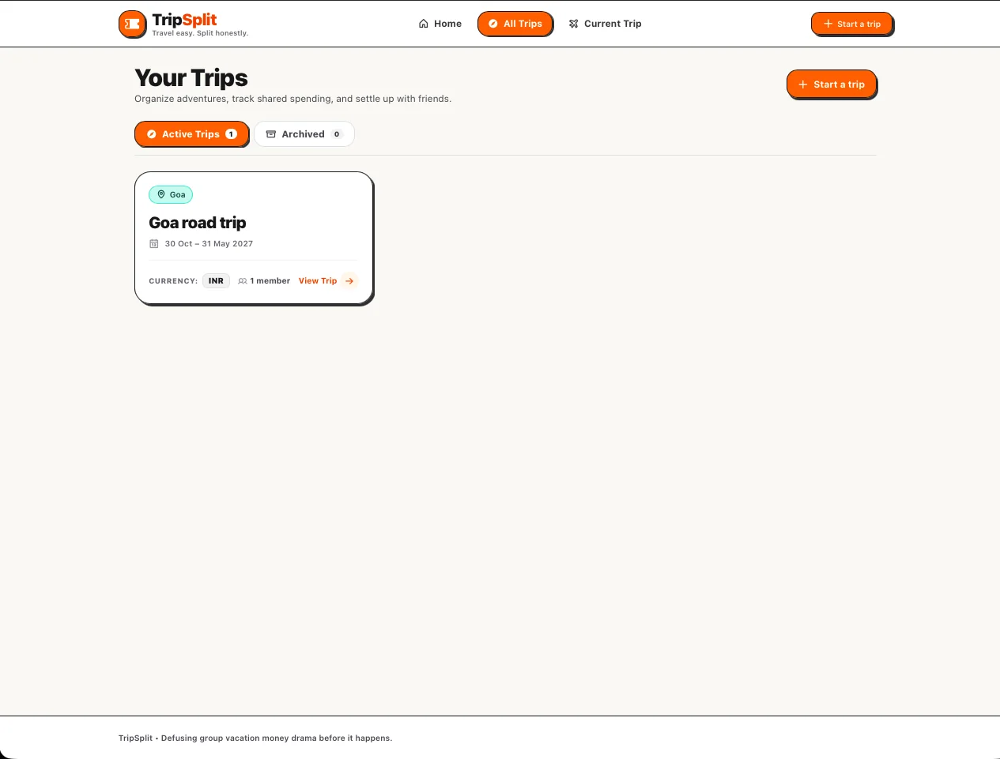
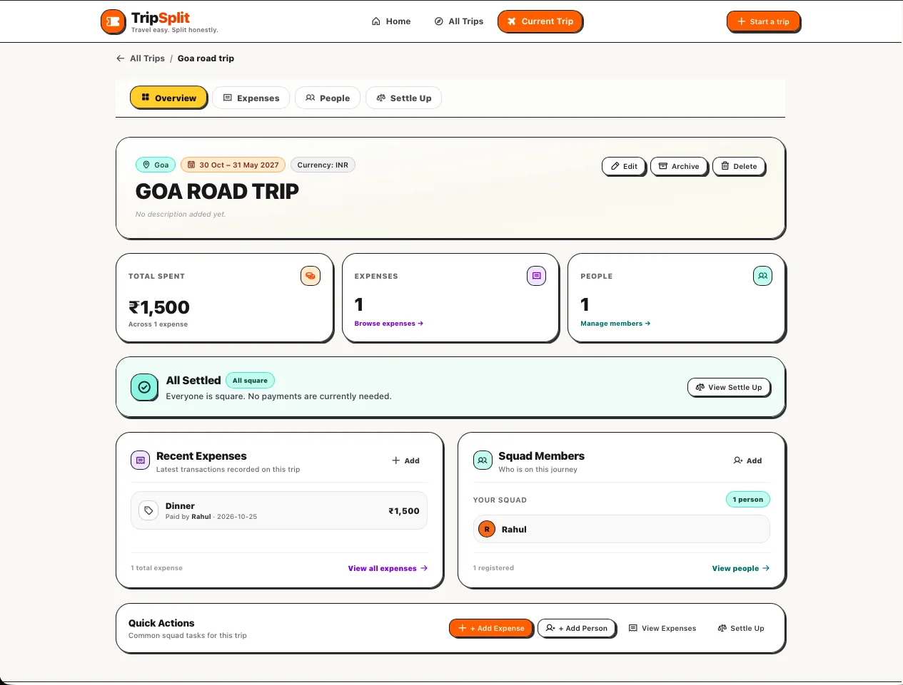
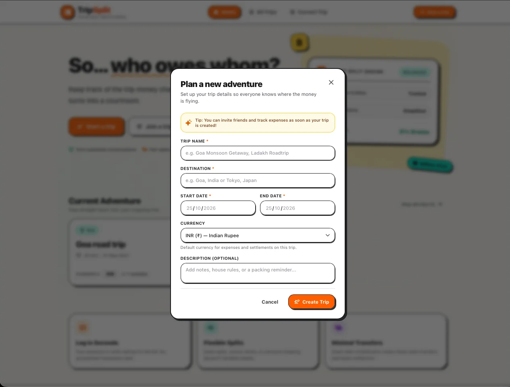
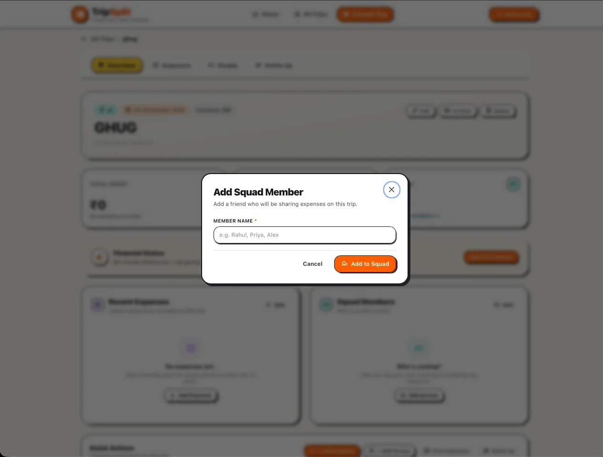
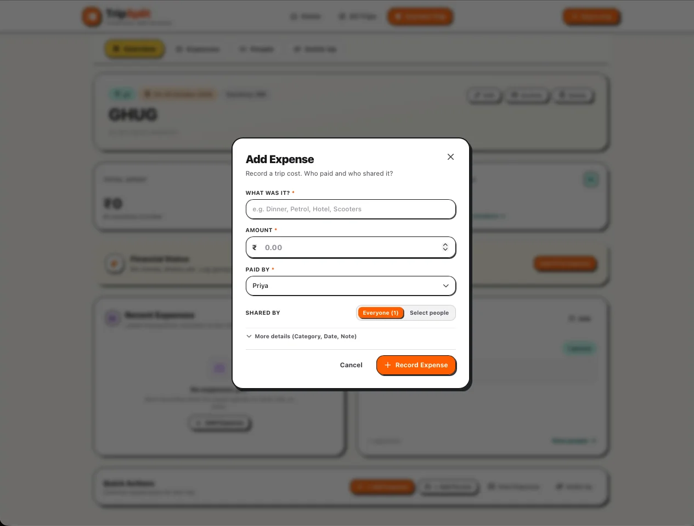

<div align="center">

# 🧳 TripSplit

### 🌍 Travel easy. Split honestly.

**💸 Record the money. TripSplit does the math.**

A modern, responsive group-trip expense manager that helps friends track shared expenses, split costs fairly, calculate individual balances, and settle up — without spreadsheets or complicated manual calculations.

<p align="center">
  
</p>

<p align="center">
  <a href="https://github.com/Krishnendu1910/TripSplit">
    
  </a>
  <a href="https://github.com/Krishnendu1910/TripSplit/issues">
    
  </a>
</p>

<p align="center">
  
</p>

<p align="center">
  
  
  
  
</p>

<p align="center">
  
  
  
  
</p>

**[📂 Explore Repository](https://github.com/Krishnendu1910/TripSplit)** · **[🐛 Report an Issue](https://github.com/Krishnendu1910/TripSplit/issues)**

</div>

---

## 📌 Table of Contents

- [💡 Overview](#-overview)
- [🎯 The Problem](#-the-problem)
- [✅ The Solution](#-the-solution)
- [✨ Key Features](#-key-features)
- [🔄 How TripSplit Works](#-how-tripsplit-works)
- [🧮 The Settlement Engine](#-the-settlement-engine)
- [🧰 Technology Stack](#-technology-stack)
- [🏗️ Architecture](#️-architecture)
- [🚧 Project Status](#-project-status)
- [🖼️ Application Preview](#-application-preview)
- [⚙️ Getting Started](#️-getting-started)
- [🧪 Development Commands](#-development-commands)
- [🧭 Application Routes](#-application-routes)
- [📁 Project Structure](#-project-structure)
- [🔐 Financial Accuracy and Data Integrity](#-financial-accuracy-and-data-integrity)
- [♿ Accessibility and Responsive Design](#-accessibility-and-responsive-design)
- [🧪 Testing and Quality](#-testing-and-quality)
- [⚠️ Known Limitations](#️-known-limitations)
- [🛣️ Roadmap](#️-roadmap)
- [🤝 Contributing](#-contributing)
- [📄 License](#-license)
- [👨‍💻 Author](#-author)


## 💡 Overview

TripSplit is a client-side group expense management application designed to make shared travel expenses easier to organize and settle.

When a group travels together, one person might pay for petrol, another might book the hotel, and someone else might cover meals. At the end of the trip, figuring out everyone's share can become confusing.

TripSplit provides a structured way to manage this process.

Users can create trips, maintain participant lists, record shared expenses, choose how expenses should be divided, and view calculated balances and settlement suggestions.

The application is built with React and JavaScript, with a dedicated financial domain layer for calculations and Zustand for application state management. Trip data is currently stored in the browser rather than synchronized through a remote backend.

The long-term goal is to make TripSplit a complete, reliable group-expense management product that can grow beyond a local browser application.

> **Project status:** TripSplit is under active development. The repository contains a substantial working application, including trip management, expense splitting, participant management, settlements, local persistence, and automated tests. Cloud synchronization, authentication, and other advanced capabilities should not be considered implemented merely because they appear on the roadmap.

## 🎯 The Problem

Group trips often create a familiar financial problem:

- One person pays for transportation.
- Another person pays for accommodation.
- Someone else pays for food and activities.
- Not everyone participates in every expense.
- Different expenses may need different splitting methods.
- People forget who paid what.
- The group struggles to calculate who owes whom.

Spreadsheets can solve much of the arithmetic, but they require manual data entry, formula maintenance, and repeated balance checking.

Group chats make coordination easier, but they are not designed to maintain a reliable financial record.

The result is often a long discussion about small amounts of money that should have been easy to settle.

## ✅ The Solution

TripSplit brings trip management, participant records, expense tracking, and settlement calculations into one interface.

Instead of manually calculating the final amount owed by each person, users can record their expenses and let the application's financial logic calculate the resulting balances.

The intended experience is straightforward:

```text
        🧳 Create a Trip
               |
               v
        👥 Add Participants
               |
               v
        💸 Record Expenses
               |
               v
        🧮 Calculate Fair Shares
               |
               v
        📊 Calculate Net Balances
               |
               v
        🤝 Generate Settlements
               |
               v
        ✅ Settle Up
```

TripSplit is designed to reduce administrative work while keeping the underlying calculations understandable and testable.

## ✨ Key Features

### 🧳 Trip Management

Organize expenses around individual trips rather than keeping every record in one global list.

The application includes trip-oriented screens and state management for managing trip records.

The intended trip lifecycle includes:

- Create a trip.
- View the trips you have recorded.
- Open a trip's overview.
- Manage its participants and expenses.
- Review calculated balances and settlement suggestions.
- Edit, archive, or delete a trip where supported by the current interface.

Each trip acts as an independent financial workspace.

### 👥 Participant Management

Maintain a list of people who are part of a trip.

Participant management supports the broader expense workflow by identifying who participated in a trip and whose balances need to be calculated.

The data model uses stable participant identifiers rather than relying exclusively on display names. This allows a participant's name to be changed without changing their identity in existing expense records.

Participant removal must also account for existing financial references to prevent inconsistent records.

### 💸 Expense Tracking

Record expenses against a specific trip and identify who paid for them.

Examples include:

- Fuel and transportation.
- Hotel bookings.
- Meals and snacks.
- Groceries and water.
- Activities and tickets.
- Other shared trip costs.

Expense records provide the foundation for calculating trip totals, participant shares, net balances, and settlement instructions.

Expense editing and deletion should preserve the integrity of the associated trip and participant records.

### 🧮 Multiple Expense-Splitting Methods

TripSplit's financial model supports different ways of allocating expenses.

| Splitting Method | Description |
|---|---|
| Equal split | Divide an expense equally among selected participants. |
| Custom amounts | Specify the amount assigned to each participant. |
| Percentage split | Allocate an expense using participant percentages. |
| Shares-based split | Divide an expense according to assigned shares. |
| Selected participants | Include only the people who participated in a particular expense. |

The available options depend on the expense form and the current implementation.

For example, a hotel bill may be shared by everyone, while a particular meal may be divided only among the people who attended it.

This flexibility helps the application model real group-trip expenses more accurately than a single per-person average.

### 📊 Expense Summaries and Balances

TripSplit calculates financial information from recorded trip data.

The financial model distinguishes between:

- Total expenditure.
- Amount paid by each participant.
- Fair share of the expenses.
- Net amount owed to or receivable by each participant.
- Suggested transfers between participants.

The goal is to give users a clear answer to three questions:

**Who needs to pay? Who should receive money? How much?**

### 🤝 Settlement Suggestions

The settlement engine converts net participant balances into actionable payment instructions.

Instead of asking every participant to reimburse every other participant individually, the engine matches participants who owe money with participants who should receive money.

For example:

```text
Alex paid more than their share.

Sam owes Alex ₹300.
Riya owes Alex ₹150.

Suggested settlements:

Sam  → Alex  ₹300
Riya → Alex  ₹150
```

The names and amounts above are illustrative. Actual settlements are calculated from the expenses and participants recorded in the application.

The intended result is a simpler settlement process with fewer unnecessary transfers.

### 💾 Browser-Based Persistence

TripSplit currently uses browser-local persistence rather than a remote database.

An application persistence layer separates storage concerns from the financial and interface layers.

This allows the application to retain supported trip data between browser sessions without requiring a backend service for the current local workflow.

However, browser-local storage is not cloud synchronization. Data stored in one browser profile is not automatically shared with other users or devices.

### 📱 Responsive Interface

The application is designed to adapt to desktop, tablet, and mobile screen sizes.

Its interface uses reusable components, responsive layouts, and touch-friendly controls to keep trip management practical on smaller screens.

### 📲 Progressive Web App Foundation

The Vite configuration includes a Progressive Web App setup using `vite-plugin-pwa`.

The configuration includes a web app manifest, application icons, standalone display settings, and service-worker asset caching.

This provides a foundation for an app-like installation experience and supported offline loading behavior.

**Important:** PWA support does not mean that every application operation has been verified to work offline. Offline data behavior, caching, and recovery should be tested in the target deployment environment.

---

## 🔄 How TripSplit Works

TripSplit separates the user interface, application state, persistence, financial calculations, and settlement logic.

### Step 1: Create a Trip

Create a workspace for a specific trip.

Keeping trips separate makes it easier to understand which expenses and participants belong together.

### Step 2: Add Participants

Add the people involved in the trip.

Each participant is represented by a stable identifier so that existing financial records can continue to refer to the same person even if their display name changes.

### Step 3: Record Expenses

Create expense records containing relevant information, including the payer, amount, participants, and split configuration.

Every expense belongs to a particular trip.

### Step 4: Calculate Expense Shares

The financial domain layer calculates how much of each expense belongs to each participating person.

The calculation depends on the selected splitting method and the participants included in the expense.

### Step 5: Calculate Net Balances

TripSplit combines amounts paid and amounts owed to determine the net position of every participant.

A positive balance indicates that the person should receive money. A negative balance indicates that the person needs to pay.

### Step 6: Generate Settlements

The settlement engine matches people who owe money with people who should receive money.

The result is a list of suggested transfers that can settle the recorded balances.

### Step 7: Review and Settle

Participants can use the suggested transfers to coordinate repayments outside the application's financial calculation flow.

The application calculates suggested obligations; users should not interpret these suggestions as confirmation that money has actually been transferred.

## 🧮 The Settlement Engine

The settlement engine is an important part of TripSplit's architecture.

Its job is to turn a collection of expenses into a simpler set of payment instructions.

### Understanding Net Balances

For each participant:

```text
Net Balance = Total Paid - Total Share Owed
```

For example:

| Participant | Total Paid | Fair Share | Net Balance |
|---|---:|---:|---:|
| Alex | ₹900 | ₹300 | +₹600 |
| Sam | ₹0 | ₹300 | -₹300 |
| Riya | ₹0 | ₹300 | -₹300 |
| **Total** | **₹900** | **₹900** | **₹0** |

Alex paid ₹900 but is responsible for only ₹300 of the total expense. Alex should therefore receive ₹600.

Sam and Riya each owe ₹300.

One valid settlement is:

```text
Sam  → Alex  ₹300
Riya → Alex  ₹300
```

After these payments, the expense is fully settled.

### Why Settlement Optimization Matters

For larger groups, the number of possible reimbursement relationships can grow quickly.

TripSplit is designed to avoid unnecessary transfers by matching people with negative balances to people with positive balances.

The objective is to make the resulting instructions easier to understand and execute.

A settlement calculation must also preserve the financial invariants of the underlying trip. It should never silently lose or create money because of a rounding error or an inconsistent expense record.

---

## 🧰 Technology Stack

TripSplit uses a JavaScript-based frontend architecture.

| Technology | Role |
|---|---|
| React 19 | Component-based user interface. |
| Vite | Development server and production build tooling. |
| JavaScript ES Modules | Application language and module system. |
| React Router 7 | Client-side navigation. |
| Tailwind CSS 4 | Styling and responsive layouts. |
| Zustand 5 | Application state management. |
| date-fns 4 | Date operations and formatting. |
| Phosphor Icons | Interface iconography. |
| clsx | Conditional class-name composition. |
| tailwind-merge | Resolving conflicting Tailwind classes. |
| vite-plugin-pwa | Progressive Web App configuration. |
| Vitest | Automated test runner. |
| React Testing Library | UI testing based on user-facing behavior. |
| jsdom | Browser-like test environment. |
| ESLint | Static analysis and code-quality checks. |
| Prettier | Code formatting. |

### Why JavaScript?

TripSplit uses JavaScript and JSX rather than TypeScript.

This keeps the project aligned with its existing codebase while allowing the financial domain, state management, and interface components to remain separated into focused modules.

### Why React and Vite?

React provides the component model needed for reusable forms, cards, modals, summaries, and trip views.

Vite supports fast local development, hot module replacement, and optimized production builds.

### Why Zustand?

Zustand organizes the application's state without requiring deeply nested prop passing.

TripSplit maintains separate stores for concerns such as trip management, participant management, expense management, and UI state.

### Why a Separate Financial Domain?

Financial calculations should not depend on how a component is rendered.

By keeping calculation logic outside React components, TripSplit can change its interface without unnecessarily rewriting the rules governing expense allocation and settlement.

## 🏗️ Architecture

TripSplit follows a client-side architecture organized around feature modules and shared application infrastructure.

```text
                     TripSplit
                         |
                         v
                  React Application
                         |
             +-----------+-----------+
             |                       |
             v                       v
        UI Components            Page Routes
             |                       |
             +-----------+-----------+
                         |
                         v
                   Zustand Stores
             +-----------+-----------+
             |           |           |
             v           v           v
           Trips      People      Expenses
             |           |           |
             +-----------+-----------+
                         |
                         v
                  Finance Domain
             +-----------+-----------+
             |                       |
             v                       v
       Expense Splitting        Net Balances
                                     |
                                     v
                              Settlement Engine
                         |
                         v
                  Persistence Adapter
                         |
                         v
                  Browser Local Storage
```

### Architectural Responsibilities

**UI components**

Present information, collect user input, and provide interactive controls.

**Pages and routing**

Organize application navigation and provide the views associated with trips and settlements.

**Zustand stores**

Manage application state and coordinate state changes.

**Feature modules**

Group trip, participant, expense, financial, and settlement functionality by domain.

**Finance domain**

Calculate expense shares, trip totals, and participant balances.

**Settlement engine**

Convert calculated balances into payment suggestions.

**Persistence layer**

Handle browser-based storage separately from interface components and financial calculations.

This separation makes the application easier to maintain and gives future storage or synchronization work a clearer integration point.

## 🚧 Project Status

TripSplit is actively being developed toward a complete group-expense management product.

| Area | Status |
|---|---|
| React application and routing | Implemented foundation |
| Responsive application interface | Implemented; continued verification recommended |
| Trip management | Implemented foundation |
| Participant management | Implemented foundation |
| Expense management | Implemented foundation |
| Multiple expense-splitting methods | Supported by the financial model; verify individual UI flows |
| Net balance calculation | Implemented financial logic |
| Settlement suggestions | Implemented financial logic |
| Zustand state management | Implemented |
| Browser-local persistence | Implemented foundation |
| PWA configuration | Present in Vite configuration |
| Automated testing | Vitest and Testing Library setup present |
| Cloud synchronization | Not currently implemented |
| User authentication | Not currently implemented |
| Multi-device shared trips | Future work |
| External payment processing | Not currently implemented |

The status table describes the current repository architecture and feature foundations. It is not a guarantee that every workflow has been tested successfully in every environment.

## ## 🖥️ Application Preview

Explore TripSplit's interface for managing trips, tracking shared expenses, adding participants, and simplifying settlements.

### 🎬 Product Walkthrough

<p align="center">
  <a href="docs/assets/tripsplit-overview.mp4">
    ▶ <strong>Watch the TripSplit Product Walkthrough (MP4)</strong>
  </a>
</p>

### 🧳 Trips Overview

View active and archived trips, including destinations, trip dates, currencies, and participant counts.

<p align="center">
  
</p>

### 📊 Trip Dashboard

Get an overview of total spending, recorded expenses, squad members, settlement status, recent transactions, and quick actions.

<p align="center">
  
</p>

### ✨ Create a Trip

Create a trip by entering its name, destination, start date, end date, currency, and optional description.

<p align="center">
  
</p>

### 👥 Add a Participant

Add friends to your trip so they can be included in the expense-sharing workflow.

<p align="center">
  
</p>

### 💸 Record an Expense

Enter the expense name and amount, choose who paid, select who shared the expense, and optionally add further details.

<p align="center">
  
</p>

---

**TripSplit — Travel easy. Split honestly.**

Record the money. TripSplit does the math.

## ⚙️ Getting Started

Follow these instructions to run TripSplit locally.

### Prerequisites

Install the following:

- [Git](https://git-scm.com/)
- [Node.js](https://nodejs.org/) with a compatible npm version.
- A code editor such as [Visual Studio Code](https://code.visualstudio.com/).
- A modern web browser.

You do not need a MongoDB instance or backend server for the current browser-local application.

### 1. Clone the Repository

```bash
git clone https://github.com/Krishnendu1910/TripSplit.git
cd TripSplit
```

### 2. Install Dependencies

Run the following command from the project root:

```bash
npm install
```

### 3. Start the Development Server

```bash
npm run dev
```

Vite will display a local URL in the terminal, usually:

```text
http://localhost:5173
```

Open the displayed URL in your browser.

### 4. Start Exploring

Use the application to explore its trip-oriented workflow:

1. Open the home page.
2. Start creating a trip.
3. Add participants.
4. Record expenses against the trip.
5. Review expense summaries and balances.
6. Open the settlement view to inspect suggested transfers.

The exact options available depend on the current implementation.

### Local Data Note

TripSplit currently stores application data locally in the browser. Clearing site data, changing browser profiles, or moving to another device can affect access to saved records.

Do not treat browser-local data as a cloud backup.

## 🧪 Development Commands

The project defines the following npm scripts.

### Development Server

```bash
npm run dev
```

Starts Vite in development mode.

### Production Build

```bash
npm run build
```

Builds the application for production.

The generated build output is placed in the `dist/` directory.

### Preview Production Build

```bash
npm run preview
```

Starts Vite's local preview server for the generated production build.

### Run Tests

```bash
npm run test
```

Runs the Vitest test suite once.

### Watch Tests

```bash
npm run test:watch
```

Runs Vitest in watch mode for ongoing development.

### Lint the Project

```bash
npm run lint
```

Runs ESLint against the project.

### Format the Code

```bash
npm run format
```

Runs Prettier with the project's configured formatting command.

**Note:** The presence of these scripts does not prove that they all pass on the current commit. Run them in your local environment or in CI to verify the current project state.

## 🧭 Application Routes

The application uses React Router to organize the primary views.

| Route | Purpose |
|---|---|
| `/` | Home page and entry point. |
| `/trips` | Trip listing. |
| `/trips/:tripId` | Trip overview. |
| `/trips/:tripId/expenses` | Trip expense view. |
| `/trips/:tripId/people` | Trip participant view. |
| `/trips/:tripId/settlement` | Settlement view for a particular trip. |
| `/trips/:tripId/settle` | Alternate settlement route. |
| `/settlement` | Redirects to an appropriate trip's settlement view when a trip is available. |

Unknown routes are handled by a not-found page.

Routes that reference a particular trip depend on the corresponding trip data being available.

## 📁 Project Structure

The repository separates application pages, feature modules, shared components, state stores, utilities, and persistence.

```text
TripSplit/
│
├── public/
│   ├── _redirects
│   ├── favicon.svg
│   ├── icons.svg
│   └── PWA assets
│
├── src/
│   ├── assets/
│   │
│   ├── components/
│   │   ├── layout/
│   │   └── ui/
│   │
│   ├── constants/
│   │
│   ├── features/
│   │   ├── trips/
│   │   │   └── components/
│   │   ├── participants/
│   │   ├── expenses/
│   │   ├── finance/
│   │   └── settlements/
│   │
│   ├── hooks/
│   │
│   ├── lib/
│   │   └── persistence/
│   │
│   ├── pages/
│   │   ├── HomePage.jsx
│   │   ├── TripsPage.jsx
│   │   ├── TripDetailPage.jsx
│   │   └── NotFoundPage.jsx
│   │
│   ├── store/
│   │   ├── useTripStore.js
│   │   ├── useParticipantStore.js
│   │   ├── useExpenseStore.js
│   │   └── useUIStore.js
│   │
│   ├── test/
│   │   └── setup.js
│   │
│   ├── utils/
│   │
│   ├── App.jsx
│   ├── App.test.jsx
│   ├── index.css
│   └── main.jsx
│
├── .gitignore
├── eslint.config.js
├── index.html
├── package.json
├── package-lock.json
├── vite.config.js
└── README.md
```

This is a high-level guide to the project layout. Individual feature modules may contain additional components, utilities, tests, and domain-specific files.

## 🔐 Financial Accuracy and Data Integrity

Financial correctness is fundamental to an expense-splitting application.

TripSplit is designed around several important invariants and data-integrity principles.

### 1. Expenses Belong to a Trip

Every expense and participant should remain associated with the correct trip.

```text
expense.tripId
participant.tripId
```

This relationship helps prevent records from one trip from affecting another trip's balances.

### 2. Participant Identity Remains Stable

A participant's identifier should not change just because their name is edited.

Stable identity prevents existing expense references from becoming invalid after a simple profile change.

### 3. Financial References Must Remain Valid

Removing a participant must account for any expenses and balance calculations that refer to them.

Likewise, editing or deleting an expense must preserve the consistency of its trip relationship.

### 4. Trip Deletion Must Avoid Orphaned Records

When a trip and its related data are removed, the application should avoid leaving disconnected participants or expenses behind.

### 5. Stored Data Must Be Handled Defensively

Browser storage may be missing, outdated, or malformed.

Application hydration should validate data and handle invalid records safely instead of allowing malformed stored state to crash the application.

### 6. Expense and Share Totals Must Reconcile

For a fully allocated set of expenses:

```text
Total Paid = Total Expense

Total Shares Owed = Total Expense

Sum of Net Balances = 0
```

In the final equation, positive balances represent amounts receivable and negative balances represent amounts payable.

A non-zero net balance sum can indicate a data inconsistency or a calculation/rounding problem that needs investigation.

### 7. Monetary Rounding Requires Care

Financial calculations should avoid relying on uncontrolled floating-point arithmetic for currency values.

Currency allocation and settlement calculations need explicit rounding rules so that the final participant shares reconcile with the original expense.

The complete financial workflow should continue to be tested as splitting methods and product features evolve.

## ♿ Accessibility and Responsive Design

TripSplit is designed with usability across devices and interaction methods in mind.

Important interface considerations include:

- Semantic headings and clear page structure.
- Accessible labels and descriptions.
- Visible keyboard focus.
- Keyboard-operable controls.
- Appropriate modal behavior and dismissal.
- Touch-friendly interaction targets.
- Responsive page layouts.
- Reduced-motion preferences where applicable.
- Clear visual distinction between payments owed and amounts receivable.

Accessibility should be verified as part of ongoing development rather than inferred from the use of a responsive CSS framework.

## 🧪 Testing and Quality

TripSplit uses Vitest and React Testing Library for automated testing.

The repository includes application smoke tests that check important aspects of the home page, application branding, primary actions, and responsive rendering.

The project also has a test setup configured through Vite.

### Recommended Verification Commands

Run the following before merging changes:

```bash
npm run lint
npm run test
npm run build
```

### Important Financial Test Cases

The financial domain should be tested independently of the interface, particularly for:

- Equal expense splits.
- Custom amount allocations.
- Percentage splits.
- Shares-based allocations.
- Expenses involving only selected participants.
- Participants who paid more or less than their fair share.
- Multiple participants with positive and negative balances.
- Settlement generation and balance reconciliation.
- Currency rounding.
- Empty trips and trips with no expenses.
- Invalid or missing participant references.
- Editing and deleting existing expenses.
- Trip isolation.
- Invalid or outdated persisted data.

UI tests should additionally cover the main user journeys, keyboard interactions, form validation, error states, and mobile layouts.

Do not publish test counts, coverage percentages, or passing build claims unless they have been verified against the current commit.

## ⚠️ Known Limitations

The current repository has a substantial client-side foundation, but several limitations remain important.

- **No remote backend:** The existing application does not use a remote application server or database for trip synchronization.
- **Browser-local data:** Saved records are not automatically shared across devices or users.
- **No implemented account system:** Authentication and user-account workflows are future capabilities.
- **No collaborative trip synchronization:** Multiple people cannot be assumed to be editing a single synchronized trip.
- **No integrated payment processing:** Settlement suggestions are not actual bank transfers.
- **PWA limitations:** Installation support does not guarantee every workflow functions offline.
- **Deployment-dependent routing:** Routes and client-side fallbacks need to be configured correctly on the hosting platform.
- **Verification is environment-specific:** Test, lint, and build commands must be run against the current code before release.

These limitations should be revised as corresponding features are implemented and verified.

## 🛣️ Roadmap

The roadmap describes potential extensions to the current application. Items below are future development goals, not claims of existing functionality.

### Core Expense Management

- [ ] Continue refining the trip creation and management journey.
- [ ] Improve expense entry and participant selection.
- [ ] Strengthen validation for every splitting method.
- [ ] Improve financial edge-case handling and rounding guarantees.
- [ ] Refine settlement explanations and payment instructions.
- [ ] Improve accessible interaction patterns and responsive behavior.

### Persistence and Reliability

- [ ] Strengthen data migration and recovery mechanisms.
- [ ] Improve error handling for malformed or outdated local data.
- [ ] Expand regression tests around expense and settlement calculations.
- [ ] Verify PWA caching and offline behavior.
- [ ] Add reliable export and backup workflows.

### Collaboration

- [ ] Introduce user authentication.
- [ ] Add backend-backed persistence.
- [ ] Support secure shared trips.
- [ ] Add invitation and participant-access workflows.
- [ ] Synchronize trip changes across devices.
- [ ] Handle concurrent edits and synchronization conflicts.

### Extended Product Capabilities

- [ ] Export trip expenses and settlements as CSV or JSON.
- [ ] Support shareable settlement summaries.
- [ ] Explore receipt attachments.
- [ ] Explore receipt scanning and assisted expense categorization.
- [ ] Add configurable settlement reminders.
- [ ] Evaluate integrations that make recording and settling expenses easier.

The implementation order may change as the application evolves. Each new capability should preserve financial correctness, data integrity, and usability.

## 🤝 Contributing

TripSplit is under active development, and its architecture and workflows may evolve.

Contributions that improve financial correctness, data integrity, accessibility, maintainability, or user experience are welcome.

### Suggested Workflow

1. Fork the repository.
2. Create a focused feature branch.
3. Follow the existing JavaScript and React conventions.
4. Keep financial calculations separate from presentation logic.
5. Add or update tests for changed behavior.
6. Run linting, tests, and the production build.
7. Open a pull request describing the changes and verification performed.

For financial changes, include examples covering both normal cases and important edge cases.

Bug reports and feature requests can be submitted through [GitHub Issues](https://github.com/Krishnendu1910/TripSplit/issues).

## 📄 License

A finalized standalone `LICENSE` file and licensing terms are not documented in this README.

The project owner should establish the intended license before distributing TripSplit under specific open-source terms. Until then, do not assume that the repository is available for unrestricted redistribution or commercial reuse.

## 👨‍💻 Author

**Krishnendu Sarkar**

- GitHub: [@Krishnendu1910](https://github.com/Krishnendu1910)
- LinkedIn: [Krishnendu Sarkar](https://www.linkedin.com/in/krishnendu-sarkar19/)

---

<div align="center">

### 🧳 TripSplit

**Record the money. TripSplit does the math.**

Less spreadsheet work. Clearer balances. Simpler trip settlements.

[Explore TripSplit](https://github.com/Krishnendu1910/TripSplit) · [Report an Issue](https://github.com/Krishnendu1910/TripSplit/issues)

</div>
