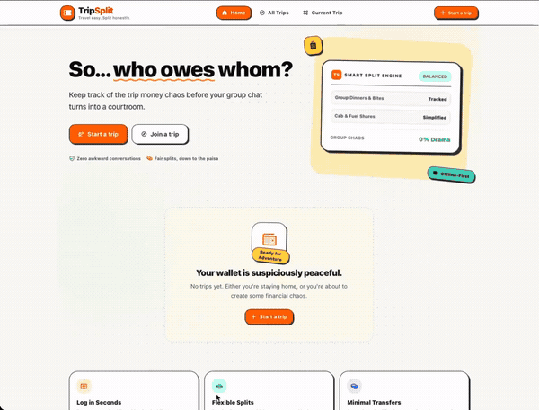

# 🧳 TripSplit

### 🌍 Travel easy. Split honestly.

**💸 Record the money. TripSplit does the math.**

A modern, responsive group-trip expense manager that helps friends track shared expenses, split costs fairly, calculate individual balances, and settle up — without spreadsheets or complicated manual calculations.

  

  
  

  

  
  
  
  

  
  
  
  

**[📂 Explore Repository](https://github.com/Krishnendu1910/TripSplit)** · **[🐛 Report an Issue](https://github.com/Krishnendu1910/TripSplit/issues)**

---

## 📌 Table of Contents

- [💡 Overview](#-overview)
- [🎯 The Problem](#-the-problem)
- [✅ The Solution](#-the-solution)
- [✨ Key Features](#-key-features)
- [🔄 How TripSplit Works](#-how-tripsplit-works)
- [🧮 The Settlement Engine](#-the-settlement-engine)
- [🧰 Technology Stack](#-technology-stack)
- [🏗️ Architecture](#️-architecture)
- [🚧 Project Status](#-project-status)
- [🖼️ Application Preview](#-application-preview)
- [⚙️ Getting Started](#️-getting-started)
- [🧪 Development Commands](#-development-commands)
- [🧭 Application Routes](#-application-routes)
- [📁 Project Structure](#-project-structure)
- [🔐 Financial Accuracy and Data Integrity](#-financial-accuracy-and-data-integrity)
- [♿ Accessibility and Responsive Design](#-accessibility-and-responsive-design)
- [🧪 Testing and Quality](#-testing-and-quality)
- [⚠️ Known Limitations](#️-known-limitations)
- [🛣️ Roadmap](#️-roadmap)
- [🤝 Contributing](#-contributing)
- [📄 License](#-license)
- [👨‍💻 Author](#-author)

